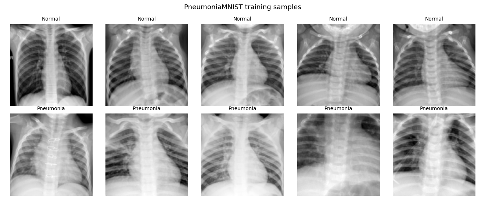
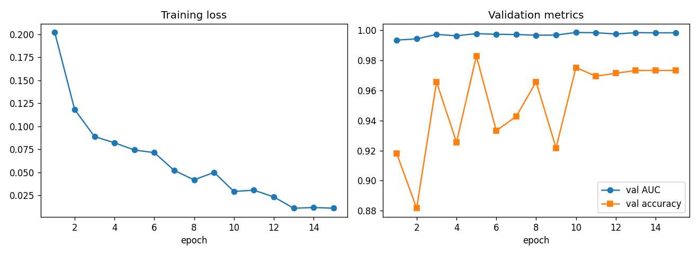
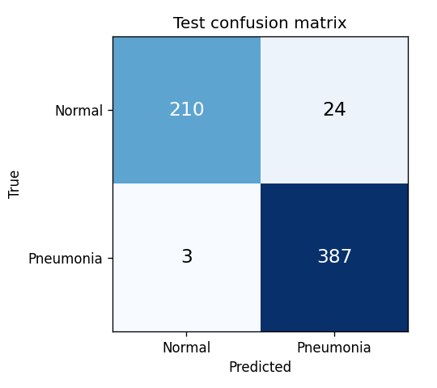
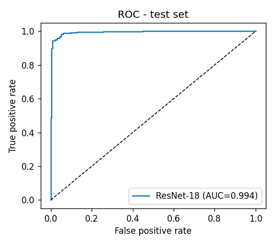
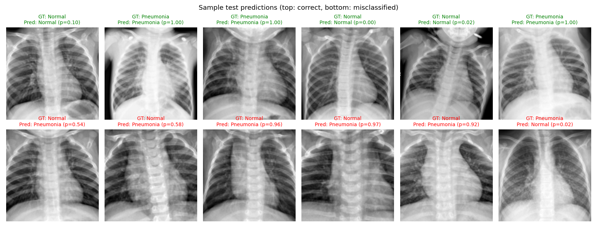

# Project 1 — Medical Image Classification and Analysis (Pneumonia Detection from Chest X-rays)

## Problem statement
Pneumonia is a leading cause of death in children under five. Diagnosis relies on a radiologist reading a
chest X-ray, and radiologists are in short supply in many hospitals. We want a model that reads a paediatric
chest X-ray and says whether it shows pneumonia, so that suspicious scans can be flagged for review first.

## Objective
- Build a binary classifier (**Normal** vs **Pneumonia**) for chest radiographs.
- Prioritise **sensitivity** (missing a pneumonia case is worse than a false alarm) while keeping specificity high.
- Evaluate on a held-out, patient-independent test set using clinically meaningful metrics.

## Dataset
**PneumoniaMNIST** (MedMNIST v2), derived from the Guangzhou Women and Children's Medical Center paediatric
chest X-ray dataset (Kermany et al., *Cell* 2018).

| Split | Images | Normal | Pneumonia |
|---|---|---|---|
| Train | 4,708 | 1,214 | 3,494 |
| Validation | 524 | 135 | 389 |
| Test | 624 | 234 | 390 |

- Resolution: 128 × 128 grayscale (the MedMNIST+ larger-size release)
- Link: <https://medmnist.com/> · Zenodo: <https://zenodo.org/records/10519652> · Original: <https://data.mendeley.com/datasets/rscbjbr9sj/2>
- Licence: CC BY 4.0
- **Downloaded automatically** by the script (`medmnist` package) into `data/` (not committed). See [DATASET.md](DATASET.md).



## Methodology
1. **Pre-processing** — pixel values scaled to [0,1] and normalised (mean 0.5, std 0.5).
2. **Augmentation (train only)** — random rotation ±10°, translation ±5 %, scale 0.95–1.05,
   brightness/contrast jitter ±20 %. Horizontal flips are *not* used because the heart is on the left
   side, so flipping would create anatomically wrong images.
3. **Class imbalance** — the training set is ~1:3 Normal:Pneumonia, so the cross-entropy loss uses
   inverse-frequency class weights.
4. **Model** — ResNet-18 pretrained on ImageNet (transfer learning). The first convolution is converted
   to accept 1-channel input by summing its RGB filters, so the pretrained weights are kept. The final layer is
   replaced by a 2-class head.
5. **Training** — AdamW (lr 1e-3, wd 1e-4), One-Cycle LR schedule, batch 64, 15 epochs, on an RTX 5080 GPU (~4 min).
   The checkpoint with the best **validation AUC** is kept (model selection never sees the test set).
6. **Evaluation** — accuracy, precision, recall (sensitivity), specificity, F1, ROC-AUC and confusion matrix on the test split.

## Tools / libraries
Python 3.10, PyTorch 2.7, torchvision, MedMNIST, scikit-learn, NumPy, Matplotlib.

## How to run
```bash
pip install -r requirements.txt
python src/train.py            # downloads data, trains, evaluates, writes results/
python src/train.py --epochs 5 # quicker run
```
Works on CPU too (slower, ~30–40 min).

## Results (test set, 624 images)

| Metric | Value |
|---|---|
| Accuracy | **95.67 %** |
| ROC-AUC | **0.9935** |
| Sensitivity (recall, Pneumonia) | **99.23 %** |
| Specificity | 89.74 % |
| Precision (Pneumonia) | 94.16 % |
| F1 (Pneumonia) | 0.9663 |

Confusion matrix: of 390 pneumonia cases, **3 were missed**. Of 234 normal scans, 24 were false alarms.
Full numbers are in [`results/metrics.json`](results/metrics.json) and
[`results/classification_report.txt`](results/classification_report.txt).

| Training curves | Confusion matrix | ROC |
|---|---|---|
|  |  |  |

**Sample input / output** (top row correct, bottom row misclassified; *p* = predicted pneumonia probability):



## Trained model
`models/resnet18_pneumonia.pt` is the PyTorch `state_dict` of the best epoch (by validation AUC). It expects a
1-channel 128×128 input.
```python
import torch, torch.nn as nn
from torchvision.models import resnet18
m = resnet18(); m.conv1 = nn.Conv2d(1, 64, 7, 2, 3, bias=False); m.fc = nn.Linear(512, 2)
m.load_state_dict(torch.load("models/resnet18_pneumonia.pt", map_location="cpu")); m.eval()
```

## Conclusion
A transfer-learned ResNet-18 detects pneumonia on chest X-rays with 0.994 ROC-AUC and 99.2 % sensitivity on
unseen test data. Almost all errors are false positives on normal scans, which is the safer type of error for a
screening tool. The model is a good triage aid, not a replacement for a radiologist. Limitations are discussed in
the [project report](REPORT.md).
