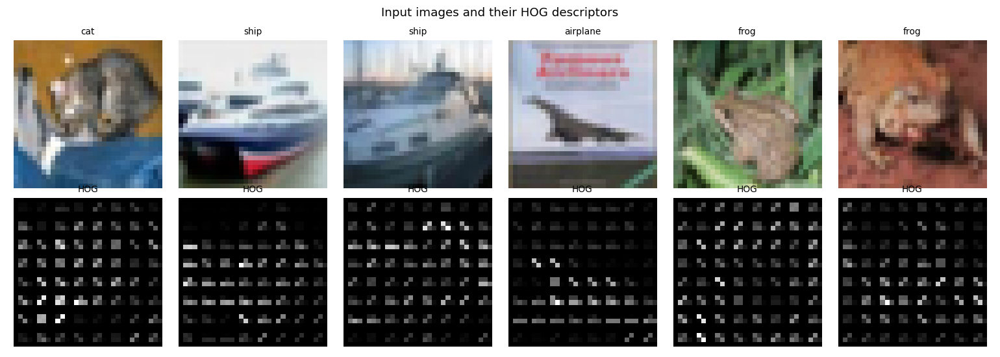
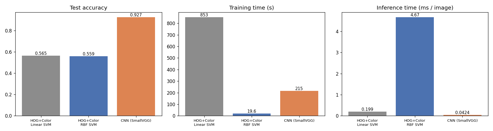
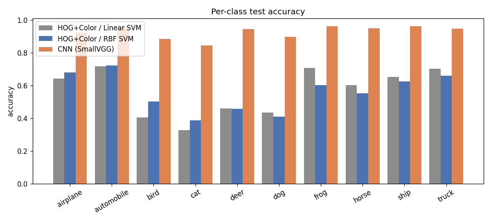
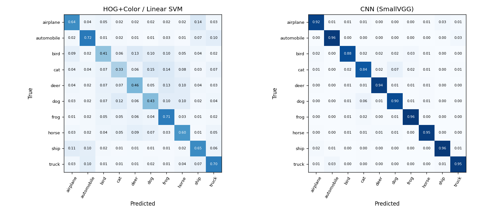
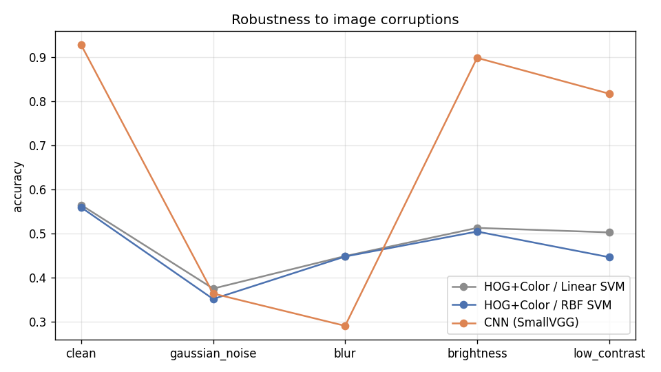
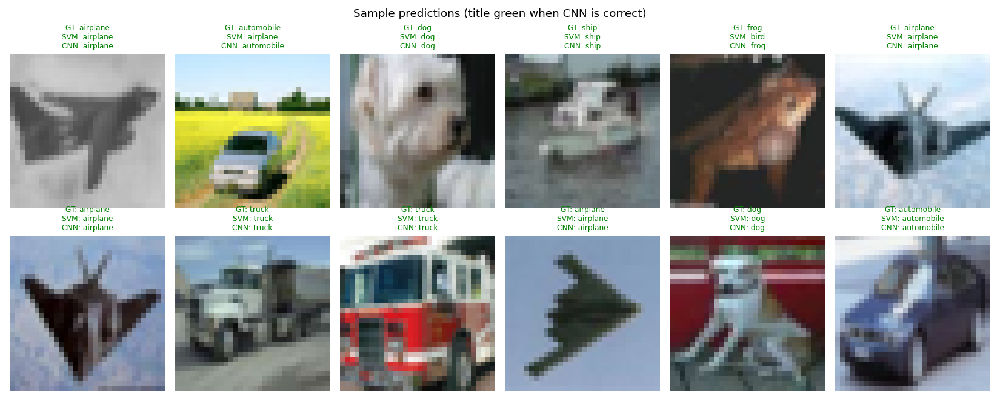

# Project 2 — Traditional Computer Vision vs Deep Learning

## Problem statement
Before deep learning, image recognition used **hand-crafted features** (edges, gradients, colour histograms)
fed into a classical classifier such as an SVM. CNNs now learn features directly from pixels. This project asks:
*how large is the gap in practice, what does each approach cost, and does deep learning win under every condition?*

## Objective
- Build a traditional pipeline (**HOG + colour histogram → SVM**) and a deep pipeline (**CNN trained from scratch**) for the same task.
- Compare them on the **same test set** for accuracy, per-class behaviour, training cost, inference speed and
  **robustness to image corruptions** (noise, blur, brightness, contrast).

## Dataset
**CIFAR-10** (Krizhevsky, 2009): 60,000 colour images, 32 × 32 px, 10 balanced classes
(airplane, automobile, bird, cat, deer, dog, frog, horse, ship, truck).

| Split | Images |
|---|---|
| Train | 50,000 (5,000 per class) |
| Test | 10,000 (1,000 per class) |

Link: <https://www.cs.toronto.edu/~kriz/cifar.html>. Downloaded automatically through `torchvision.datasets.CIFAR10`
into `data/` (see [DATASET.md](DATASET.md)).

## Methodology

### A/B — Traditional pipeline
1. **Pre-processing**: RGB → grayscale (for HOG) and RGB → HSV (for colour).
2. **HOG** (Dalal & Triggs): 9 orientation bins, 8×8-px cells, 2×2-cell blocks, L2-Hys normalisation → 324-D shape descriptor.
3. **Colour histogram**: 8×8×8 joint HSV histogram, L1-normalised → 512-D.
4. Concatenate (836-D) → standardise (z-score).
5. Classifiers: **A. Linear SVM** (C = 0.01, all 50k images) and **B. RBF-kernel SVM** (C = 10, a 10k random subset,
   because kernel SVM training scales roughly quadratically).



### C — Deep-learning pipeline
- **SmallVGG** CNN: 3 blocks of [Conv3×3-BN-ReLU ×2 → MaxPool] (64/128/256 channels) → global average pool → dropout → linear. 1.15 M parameters.
- Normalisation with the CIFAR mean/std. **Augmentation**: random crop (pad 4) + horizontal flip.
- SGD + Nesterov momentum, One-Cycle LR (max 0.1), weight decay 5e-4, label smoothing 0.1, batch 128, 30 epochs, GPU.

### Robustness test
The 10k test images are corrupted with: Gaussian noise (σ = 20), Gaussian blur (5×5, σ = 1.2), brightness +60,
and contrast × 0.4. Every model is evaluated **without retraining**.

## Tools / libraries
Python 3.10, OpenCV, scikit-image (HOG), scikit-learn (SVMs), PyTorch + torchvision (CNN, CIFAR-10 loader), NumPy, Matplotlib.

## How to run
```bash
pip install -r requirements.txt
python src/compare.py                 # full experiment (~45 min after download; the linear SVM on 50k samples is the slowest part)
python src/compare.py --epochs 10     # quicker CNN
```

## Results (CIFAR-10 test set, 10,000 images)

| Pipeline | Accuracy | Macro-F1 | Train images | Train time | Inference / image |
|---|---|---|---|---|---|
| HOG + Colour → Linear SVM | 56.5 % | 0.558 | 50,000 | 853 s (CPU) | 0.20 ms (CPU) |
| HOG + Colour → RBF SVM | 55.9 % | 0.560 | 10,000 | 20 s (CPU) | 4.67 ms (CPU) |
| **CNN (SmallVGG)** | **92.7 %** | **0.927** | 50,000 | 215 s (GPU) | **0.04 ms** (GPU, batched) |



**Per-class accuracy.** The traditional pipeline does best on classes with distinctive shape or colour
(automobile 72 %, frog 71 %, truck 70 %) and worst on animals with variable pose (cat 33 %, bird 41 %, dog 43 %).
The CNN is above 84 % on every class. Its hardest class is also *cat* (85 %).

| Per-class accuracy | Confusion matrices |
|---|---|
|  |  |

**Robustness (accuracy under corruption)**

| Corruption | Linear SVM | RBF SVM | CNN |
|---|---|---|---|
| clean | 0.565 | 0.559 | **0.927** |
| Gaussian noise | **0.376** | 0.352 | 0.364 |
| blur | **0.449** | 0.448 | 0.291 |
| brightness +60 | 0.513 | 0.505 | **0.898** |
| low contrast | 0.503 | 0.447 | **0.817** |



The CNN handles photometric changes (brightness, contrast) well, because batch-norm and normalisation absorb them.
It **collapses under noise and blur** (−56 and −64 points) and falls *below* the hand-crafted pipeline. HOG
averages gradients over 8×8 cells, which makes it inherently tolerant to blur. The CNN learned high-frequency
texture cues that blur removes and noise imitates.

**Sample predictions** (SVM vs CNN):



## Trained models
Saved in `models/`:
- `hog_color_linear_svm.joblib`: scikit-learn pipeline (StandardScaler → LinearSVC). Its input is the
  `extract_features()` vector from `src/compare.py`.
- `hog_color_rbf_svm.joblib`: scikit-learn pipeline (StandardScaler → RBF SVC), same input.
- `small_vgg_cifar10.pt`: PyTorch `state_dict` of `SmallVGG`. Its input is a normalised 3×32×32 tensor (see `to_tensor()`).
```python
import joblib, torch, sys; sys.path.insert(0, "src")
from compare import SmallVGG, extract_features, to_tensor
svm = joblib.load("models/hog_color_linear_svm.joblib")
cnn = SmallVGG(); cnn.load_state_dict(torch.load("models/small_vgg_cifar10.pt", map_location="cpu")); cnn.eval()
```

## Conclusion
Learned features beat hand-crafted ones by **36 percentage points** on CIFAR-10 (92.7 % vs 56.5 %). The CNN is
also faster at inference on a GPU. The traditional pipeline still has real advantages: no GPU is needed, the
RBF-SVM trains in 20 s on 10k images, every feature is interpretable (HOG visualisation), and it is **more robust to
blur and sensor noise** than a CNN trained only on clean data. Deep learning wins on accuracy, but its robustness
has to be designed in (noise/blur augmentation), as discussed in the [report](REPORT.md).
