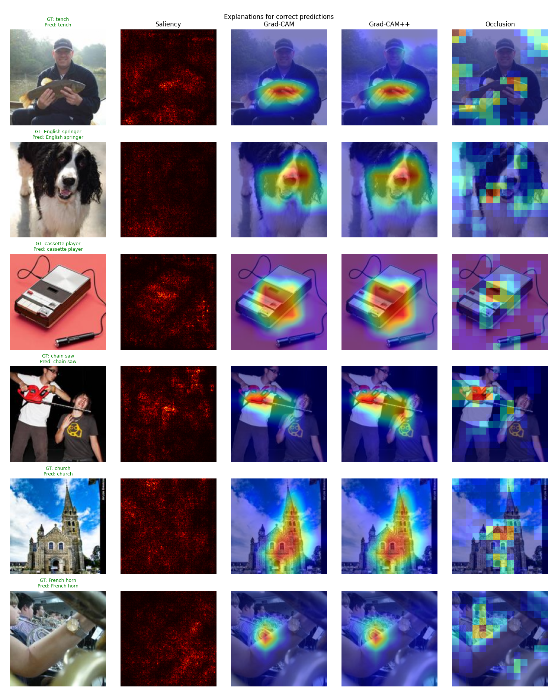
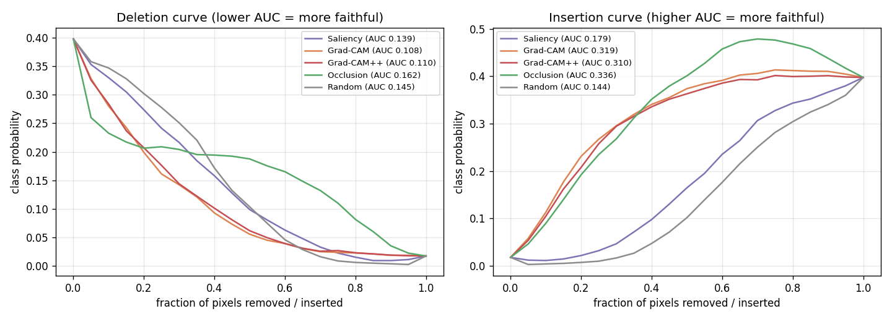
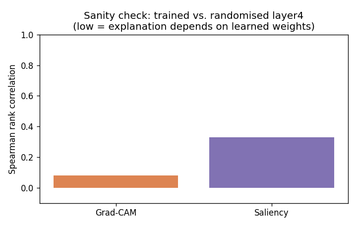
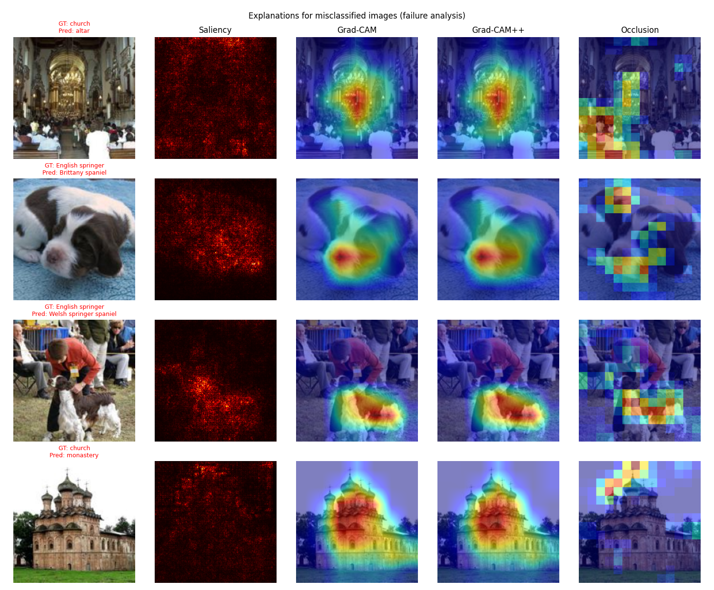

# Project 3 — Explainable AI for Object Recognition



## Problem statement
Deep CNNs recognise objects very accurately, but they are black boxes. Before a model is used in a
safety-critical or regulated setting, we need to know **why** it predicted a class. Is it looking at the object,
or at a shortcut in the background? Attribution ("heat-map") methods claim to answer this, but different methods
produce different maps, and some maps look convincing without reflecting what the model actually computes.

## Objective
1. Recognise objects with a pretrained ImageNet CNN and measure its accuracy.
2. Implement four explanation methods from scratch: **Vanilla Gradient Saliency, Grad-CAM, Grad-CAM++ and Occlusion Sensitivity**.
3. **Quantitatively** evaluate how faithful each explanation is (deletion/insertion metrics, random baseline,
   model-randomisation sanity check), instead of judging only by eye.
4. Use the explanations to analyse **failure cases**.

## Dataset
**Imagenette** (fast.ai), a 10-class subset of ImageNet: tench, English springer, cassette player, chain saw,
church, French horn, garbage truck, gas pump, golf ball, parachute.

| Split | Images |
|---|---|
| train | 9,469 (not used — the model is not retrained) |
| **val** | **3,925** (all evaluation) |

- Version: `imagenette2-160` (short side 160 px), resized/centre-cropped to 224 × 224
- Link: <https://github.com/fastai/imagenette> · archive: <https://s3.amazonaws.com/fast-ai-imageclas/imagenette2-160.tgz> (94 MB)
- Downloaded and extracted automatically by the script (see [DATASET.md](DATASET.md)).

## Methodology
**Model:** torchvision ResNet-50, ImageNet-1k weights `IMAGENET1K_V2` (no fine-tuning). Images are resized to 224 and ImageNet-normalised.

**Explanation methods** (implemented in [`src/explain.py`](src/explain.py) with forward/backward hooks on `layer4`):

| Method | Idea | Type |
|---|---|---|
| Saliency | \|∂ score / ∂ pixel\| (max over RGB) | gradient, pixel-level |
| Grad-CAM | layer4 feature maps weighted by spatially averaged gradients, ReLU | gradient × activation, 7×7 upsampled |
| Grad-CAM++ | like Grad-CAM, but with higher-order pixel-wise weights (better for multiple instances) | gradient × activation |
| Occlusion | slide a 32×32 grey patch (stride 16), record the drop in class probability | perturbation, model-agnostic (169 forward passes) |
| Random | uniform noise map | baseline |

**Evaluation of explanations** (300 random validation images, explaining the predicted class):
- **Deletion AUC** ↓: blur the most-important pixels first (in 5 % steps) and track the class probability.
  A faithful map makes the probability drop fast.
- **Insertion AUC** ↑: start from a blurred image and reveal the most-important pixels first. A faithful map makes the probability rise fast.
- **Centre energy**: share of the attribution inside the central 50 % of the image. Imagenette objects are mostly centred. The random baseline gives 0.25.
- **Sanity check** (Adebayo et al., NeurIPS 2018): re-initialise the weights of `layer4` and the classifier and measure the Spearman
  correlation between the explanations of the trained and randomised models. An explanation that **does not
  change** when the model's weights are destroyed cannot be explaining the model.

## Tools / libraries
Python 3.10, PyTorch 2.7 + torchvision (ResNet-50), NumPy, SciPy, Matplotlib, Pillow. All XAI methods are written from scratch (no Captum or pytorch-grad-cam).

## How to run
```bash
pip install -r requirements.txt
python src/explain.py               # downloads Imagenette, runs everything (about 30 min on an RTX 5080; occlusion dominates)
python src/explain.py --n_eval 50   # faster, fewer images for the faithfulness metrics
```

## Results

### Recognition accuracy (3,925 validation images)
| Metric | Value |
|---|---|
| Top-1 (full 1000-class ImageNet head) | **80.9 %** |
| Top-5 (1000 classes) | 96.9 % |
| Top-1 restricted to the 10 Imagenette classes | **99.5 %** |

Most 1000-way "errors" are confusions with closely related ImageNet classes (Welsh springer spaniel, Brittany spaniel, altar, monastery, etc.).

### Faithfulness of explanations (300 images)
| Method | Deletion AUC ↓ | Insertion AUC ↑ | Centre energy | Sanity-check correlation ↓ |
|---|---|---|---|---|
| Saliency | 0.140 | 0.179 | 0.31 | 0.33 |
| **Grad-CAM** | **0.108** | 0.319 | **0.49** | **0.08** |
| Grad-CAM++ | 0.110 | 0.310 | 0.45 | – |
| Occlusion | 0.162 | **0.336** | 0.32 | – |
| Random | 0.145 | 0.144 | 0.25 | – |



| Sanity check | Failure analysis |
|---|---|
|  |  |

**Key findings**
- **Grad-CAM and Grad-CAM++** are the most faithful overall. Deleting their top regions destroys the prediction
  fastest (25 % lower deletion AUC than random), and their insertion AUC is over 2× the random baseline.
- **Occlusion** gives the best insertion score but a deletion score *worse than random*. Its coarse 32-px maps have
  large tied/zero regions, and a single small occluder often does not change the prediction when the object is large
  or appears several times. This shows that **the choice of metric matters**.
- **Vanilla saliency** is close to random on deletion. It is also noisy, and its rank correlation stays at 0.33 after
  randomising the top of the network. Part of the map reflects image edges rather than learned features, which matches Adebayo et al.
- **Grad-CAM passes the sanity check** (correlation 0.08). It depends on the learned weights.
- **Failure analysis:** the misclassified examples are *semantically reasonable*. An English springer is labelled
  Welsh springer or Brittany spaniel (fine-grained breeds, with Grad-CAM on the face/body). A church interior is labelled
  *altar* (Grad-CAM on the altar). An onion-domed church is labelled *monastery*. The explanations show these are
  label-granularity errors, not shortcut learning.

## Conclusion
The pretrained ResNet-50 recognises Imagenette objects with 99.5 % accuracy among the 10 classes. Of the four
explanation methods, Grad-CAM gives the best balance of faithfulness (lowest deletion AUC, high insertion AUC),
localisation and trustworthiness (it passes the model-randomisation test), at the cost of one backward pass. Pixel-level
gradient saliency looks detailed but is the least reliable. Explanations should be **evaluated quantitatively**, not
only shown as pretty pictures. See [REPORT.md](REPORT.md) for limitations.
