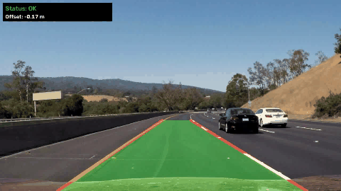
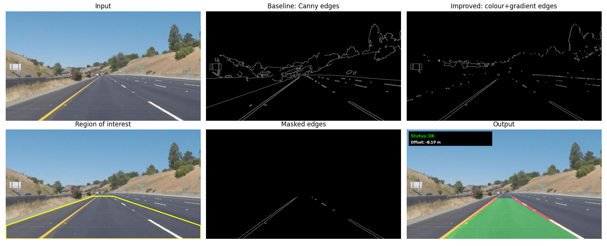
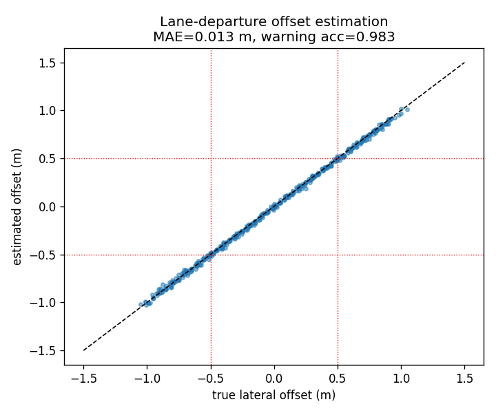
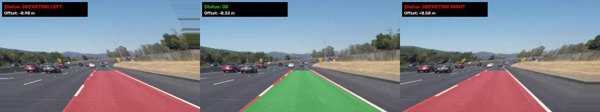
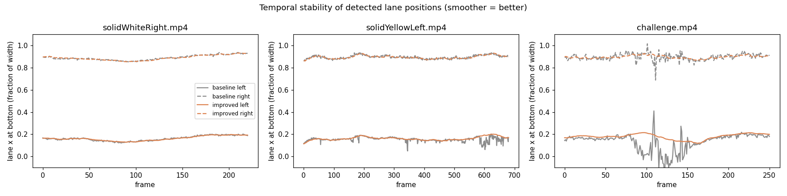
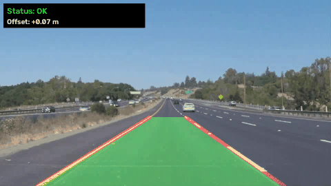

# Project 4 — Road Lane Detection and Lane Departure Warning



## Problem statement
Unintended lane departure causes a large share of single-vehicle and side-swipe crashes. A Lane Departure
Warning System (LDWS) has to find the lane boundaries in a forward-facing camera image, estimate where the
vehicle is inside the lane, and warn the driver when it drifts too far. This has to work in real time,
with no special hardware.

## Objective
- Detect the left and right ego-lane boundaries in road images and videos using **classical computer vision**
  (no learning, no training data needed).
- Estimate the vehicle's **lateral offset** from the lane centre in metres and raise a **departure warning** when |offset| > 0.5 m.
- Compare a textbook baseline with an improved pipeline, and measure accuracy, stability and speed.

## Dataset
**Udacity Self-Driving Car Nanodegree — CarND-LaneLines-P1** test data
(<https://github.com/udacity/CarND-LaneLines-P1>):

| Item | Count | Resolution | Conditions |
|---|---|---|---|
| Test images | 6 | 960×540 | white solid/dashed, yellow solid, curves |
| `solidWhiteRight.mp4` | 221 frames | 960×540 | white lanes, straight |
| `solidYellowLeft.mp4` | 681 frames | 960×540 | yellow + white lanes |
| `challenge.mp4` | 251 frames | 1280×720 | curve, concrete bridge, tree shadows, car hood |

Files are downloaded automatically into `data/` by the script (see [DATASET.md](DATASET.md)).
The dataset has **no lane ground truth**. Accuracy is therefore measured with a **controlled
lane-departure experiment** in which the true offset is known by construction, plus stability metrics on video (see below).

## Methodology


**Baseline pipeline** (textbook): grayscale → Gaussian blur → Canny edges → trapezoidal ROI →
probabilistic Hough transform → split segments by slope sign → average slope/intercept per side.

**Improved pipeline**:
1. **Colour segmentation in HLS space** — white mask with an *adaptive* lightness threshold (97th percentile of L)
   and a yellow mask on hue 15–35. HLS keeps colour separate from brightness, so shadows and the bright
   concrete bridge are handled better than in grayscale.
2. **Gradient cue** — Sobel-x on the L channel, kept only where saturation is high. This picks up faded paint.
3. Morphological closing → Canny → **hexagonal ROI** (kept wide at the bottom so lanes stay in view during a departure).
4. **Hough transform + geometric filtering** — reject segments with |slope| outside 0.45–2.0 and segments on the wrong side of the image.
5. **Length-weighted least-squares fit** `x = a·y + b` for each lane (robust to short noisy segments).
6. **Temporal tracking (video)** — exponential moving average (α = 0.2), outlier-jump rejection, and holding
   the last estimate for up to 10 missing frames.
7. **Departure estimation** — lateral offset = (image centre − lane centre) × 3.7 m / lane width in pixels,
   measured at the bottom row. Warning when |offset| ≥ 0.5 m.

## Tools / libraries
Python 3.10, OpenCV 4.x/5.x, NumPy, Matplotlib, Pillow (GIF previews).

## How to run
```bash
pip install -r requirements.txt
python src/lane_detection.py                    # downloads data, writes all results/ (images, videos, metrics)
python src/lane_detection.py --no-video-output  # metrics only, faster
python ../make_gif.py results/output_challenge.mp4 results/demo_challenge.gif 0 50 4 480   # optional GIF preview
```

## Results

### 1. Lane-departure experiment (quantitative, known ground truth)
A sideways move of the car on a flat road is the same as a horizontal **shear of the image around the
vanishing-point row**. We apply 25 known shifts (−1.2 m … +1.2 m) to 21 frames (6 test images + 15 video
frames), which gives 525 trials with exact ground-truth offsets.

| Metric | Value |
|---|---|
| Trials where both lanes were found | 402 / 525 (76.6 %) — failures happen at large shifts when one line leaves the camera view |
| Offset **MAE** | **0.013 m** |
| Offset RMSE | 0.017 m |
| Warning **precision** | **98.4 %** |
| Warning **recall** | **97.9 %** |
| Warning accuracy | 98.3 % (TP 188, FP 3, FN 4, TN 207) |

| Offset estimation | Simulated departure: left / centred / right |
|---|---|
|  |  |

### 2. Video evaluation — baseline vs improved
| Video | Pipeline | Both lanes found | Frame-to-frame jitter (% width) ↓ | Lane-width CV ↓ | FPS |
|---|---|---|---|---|---|
| solidWhiteRight | baseline | 100 % | 0.39 | 0.011 | 319 |
| solidWhiteRight | **improved** | 100 % | **0.09** | **0.007** | 76 |
| solidYellowLeft | baseline | 100 % | 0.62 | 0.026 | 346 |
| solidYellowLeft | **improved** | 100 % | **0.09** | **0.009** | 87 |
| challenge | baseline | 100 % | 2.41 | 0.110 | 217 |
| challenge | **improved** | 100 % | **0.17** | **0.023** | 54 |

*Jitter* is the mean absolute frame-to-frame change of the lane position at the bottom of the image. *Lane-width
CV* is the coefficient of variation of the detected lane width. The real lane width is constant, so lower is better.
On the challenge video the improved pipeline is **14× more stable**. All pipelines run faster than real time (25 fps) on a CPU.



### 3. Sample outputs
Annotated output videos: [`output_solidWhiteRight.mp4`](results/output_solidWhiteRight.mp4),
[`output_solidYellowLeft.mp4`](results/output_solidYellowLeft.mp4), [`output_challenge.mp4`](results/output_challenge.mp4).



Baseline (left) vs improved (right) on all test images: [`results/test_images_comparison.png`](results/test_images_comparison.png).
On `solidYellowCurve2` and `whiteCarLaneSwitch` the baseline puts the left lane inside the yellow line. The
improved pipeline fits it correctly.

## Conclusion
A classical pipeline (colour segmentation in HLS, edge detection, Hough transform, robust fitting and temporal
smoothing) detects lane boundaries reliably on highway footage, including the shadowed and bright-concrete challenge
clip. It estimates lateral offset with about 1.3 cm mean error and issues departure warnings with about 98 % precision
and recall in a controlled experiment. Speed is 50–90 fps on a CPU. The main weaknesses are the straight-line lane
model and the fixed ROI. See the [report](REPORT.md).
