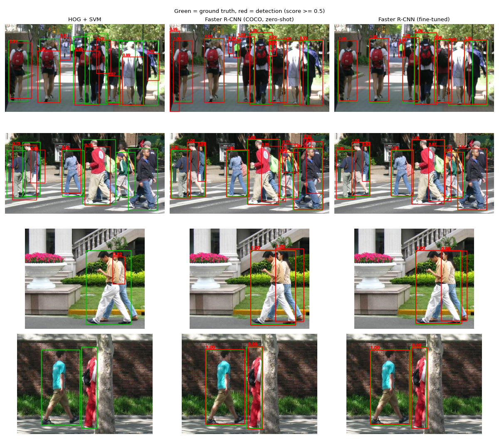
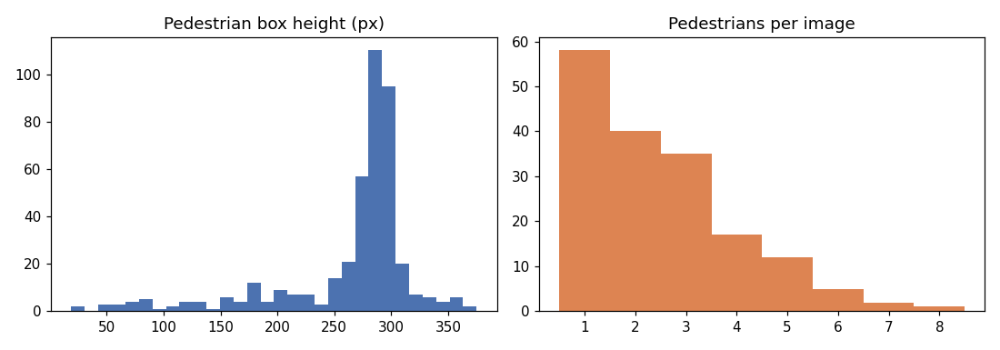
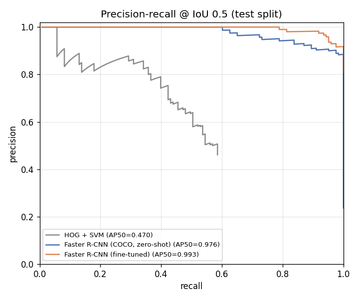
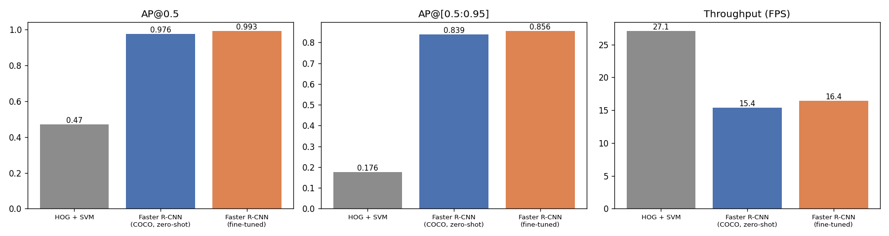
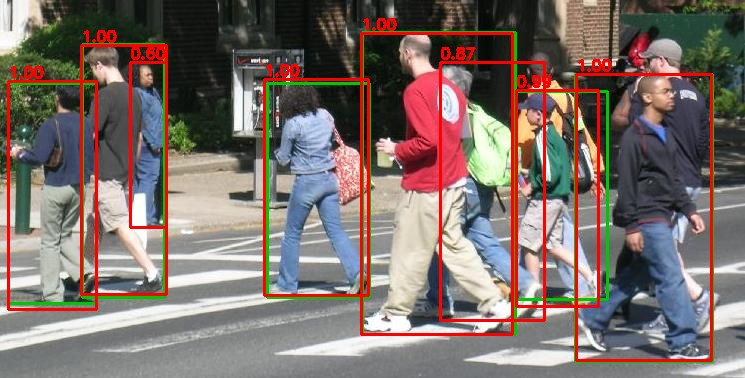
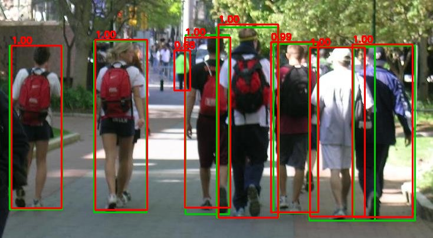

# Project 5 — Pedestrian Detection for Autonomous Robots



## Problem statement
A mobile robot (delivery robot, campus shuttle, warehouse AGV) working among people must find every pedestrian in
its camera view, with an accurate bounding box, fast enough to react. Missing a person is a safety failure.
Too many false alarms make the robot stop all the time. We need to know which detection approach gives the best
accuracy-speed trade-off and how much task-specific training helps.

## Objective
- Detect pedestrians (bounding boxes) in street images.
- Compare three generations of detectors on the same held-out test images:
  1. **HOG + linear SVM** — classical sliding-window detector (Dalal & Triggs, 2005)
  2. **Faster R-CNN (COCO-pretrained), zero-shot** — a deep detector used as-is
  3. **Faster R-CNN fine-tuned** on the target dataset (transfer learning)
- Evaluate with the standard object-detection metrics (COCO AP, precision/recall, PR curves) and speed.

## Dataset
**Penn-Fudan Pedestrian Database** (Wang, Shi, Song & Shen, ACCV 2007): photos taken around the University of
Pennsylvania and Fudan University campuses, with per-instance segmentation masks for pedestrians.

| Property | Value |
|---|---|
| Images | 170 (PNG, 253–1017 px wide, median 479 × 380) |
| Annotated pedestrians | 423 (2.5 per image) |
| Box height | 19 – 375 px (median 285) |
| Split used | **120 train / 50 test** (random, seed 0; listed in [`results/split.json`](results/split.json)) |

- Link: <https://www.cis.upenn.edu/~jshi/ped_html/> · zip: <https://www.cis.upenn.edu/~jshi/ped_html/PennFudanPed.zip> (51 MB)
- Bounding boxes are computed from the instance masks. Downloaded automatically (see [DATASET.md](DATASET.md)).



## Methodology
**1. HOG + SVM.** OpenCV's built-in people detector (64 × 128 window, HOG features, linear SVM trained on INRIA Person).
Multi-scale sliding window (scale step 1.05, stride 4 px), then non-maximum suppression (IoU 0.45). SVM margins are
mapped to (0, 1) with a sigmoid so they can be ranked. The detector's window includes a margin around the person,
so its boxes are larger than Penn-Fudan's tight boxes. A **box-shrink factor is calibrated on the training split**
(grid search, best: 15 % of width and 10 % of height per side). The test set is never used for tuning.

**2. Faster R-CNN zero-shot.** torchvision `fasterrcnn_resnet50_fpn_v2` with COCO weights. Only the `person` class (id 1) is kept.

**3. Faster R-CNN fine-tuned.** The same network, with the box predictor replaced by a 2-class head (background, pedestrian).
Trained on the 120 training images for 12 epochs: SGD (lr 0.01, momentum 0.9, wd 1e-4), cosine schedule, batch 4.
Augmentation: horizontal flip and brightness/contrast jitter. Training takes 260 s on an RTX 5080.

**Evaluation** (50 test images, 123 pedestrians): COCO-style **AP@0.5**, **AP@[0.5:0.95]**, AP@0.75, AR@100
(torchmetrics / pycocotools). Precision, recall and F1 at score ≥ 0.5 with greedy IoU-0.5 matching. Precision-recall
curves. Throughput in images/second (batch 1).

## Tools / libraries
Python 3.10, PyTorch 2.7, torchvision (Faster R-CNN), OpenCV 4 (HOG detector, NMS), torchmetrics + pycocotools (COCO mAP), NumPy, Matplotlib, Pillow.

## How to run
```bash
pip install -r requirements.txt
python src/detect.py              # download, fine-tune, evaluate all 3 detectors, write results/
python src/detect.py --epochs 4   # quicker fine-tuning
```
> Note: OpenCV 5 moved `HOGDescriptor` out of the main module. Use `opencv-python<5` (pinned in requirements.txt).

## Results (test split: 50 images, 123 pedestrians)

| Detector | AP@0.5 | AP@[.5:.95] | AP@0.75 | AR@100 | Precision* | Recall* | F1* | FPS** |
|---|---|---|---|---|---|---|---|---|
| HOG + SVM | 0.470 | 0.176 | 0.044 | 0.275 | 0.462 | 0.585 | 0.516 | 27.1 (CPU) |
| Faster R-CNN (COCO, zero-shot) | 0.976 | 0.839 | **0.946** | 0.881 | 0.544 | **1.000** | 0.705 | 15.4 (GPU) |
| **Faster R-CNN (fine-tuned)** | **0.993** | **0.856** | 0.924 | **0.900** | **0.860** | **1.000** | **0.925** | 16.4 (GPU) |

\* at score threshold 0.5, IoU ≥ 0.5  ·  \** single image, RTX 5080 / CPU, including pre-processing

| Precision-recall curves | Metric comparison |
|---|---|
|  |  |

**Observations**
- **Deep vs classical:** Faster R-CNN roughly doubles AP@0.5 (0.47 → 0.99) and improves AP@[.5:.95] about 5×. HOG misses
  partly occluded people and people in non-upright poses, and its boxes are poorly localised (AP@0.75 only 0.04).
- **Fine-tuning:** the zero-shot COCO model already finds every pedestrian (recall 1.0), but at threshold 0.5 almost half its
  detections are "false positives" (precision 0.54). Most are **real but unannotated people** in the background
  (Penn-Fudan only labels the main pedestrians, so background, seated and border-cropped people count as errors). A few are
  boxes that cover two people, or a poster/mannequin (103 false positives were inspected by hand). Fine-tuning teaches the model *this
  dataset's definition* of a pedestrian. Precision rises to 0.86 and F1 from 0.70 to 0.93.
- **Speed:** HOG runs at about 27 FPS on CPU without a GPU. Faster R-CNN runs at about 16 FPS on a laptop GPU. That is enough for a
  slow-moving robot but not for high-speed driving (see report).

Sample outputs (green = ground truth, red = fine-tuned detector):

| | |
|---|---|
|  |  |

## Trained model
`models/fasterrcnn_pennfudan.pt` is the PyTorch `state_dict` of the fine-tuned Faster R-CNN (2 classes:
background and pedestrian).
```python
import torch
from torchvision.models.detection import fasterrcnn_resnet50_fpn_v2
from torchvision.models.detection.faster_rcnn import FastRCNNPredictor
m = fasterrcnn_resnet50_fpn_v2(weights=None, weights_backbone=None)
m.roi_heads.box_predictor = FastRCNNPredictor(m.roi_heads.box_predictor.cls_score.in_features, 2)
m.load_state_dict(torch.load("models/fasterrcnn_pennfudan.pt", map_location="cpu")); m.eval()
```

## Conclusion
For pedestrian detection on a robot, a deep two-stage detector is far more accurate than the classical HOG + SVM
pipeline (AP@0.5 0.99 vs 0.47). Fine-tuning a COCO-pretrained Faster R-CNN on only 120 images raises precision
from 0.54 to 0.86 while keeping recall at 100 %. HOG remains attractive only where no GPU is available. The
[report](REPORT.md) covers the limitations: a small test set, incomplete annotations, and speed on embedded hardware.
